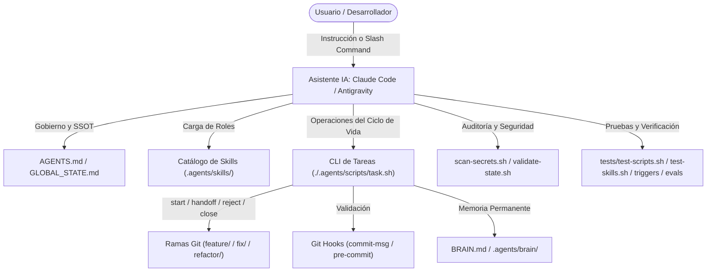

# Mapa Mental del Sistema y Flujo de Datos (System Map)

> **Propósito**: Proveer a los agentes una visión panorámica instantánea de la arquitectura, componentes, scripts y arnés de pruebas del Sistema Multi-Agente sin tener que inspeccionar docenas de archivos.

---

## 1. Diagrama de Arquitectura del Sistema Multi-Agente

---

## 2. Mapa de Componentes y Directorios Clave

- **Catálogo de Skills (`.agents/skills/`)**:
  - Contiene las 38 skills estándar de roles especializados (`orchestrator-agent`, `research-agent`, `backend-agent`, `frontend-agent`, `qa-security-agent`, etc.), flujos (`iniciar-proyecto`, `adoptar-proyecto`, `crear-plan`, `nueva-tarea`, `pr-review`, `handoff`, `qa-review`, `bugfix`, `refactor`, `cerrar-fase`, `release`, `aprender`, `estado`), stacks (`stack-*`) y técnicas (`testing-strategy`, `e2e-testing`, `async-jobs`, `payments-stripe`, `seo-web`, `web-performance`, `i18n`, `security-hardening`, `observability`).
  - Cada skill contiene frontmatter con nombre y descripción con límites negativos, protocolo paso a paso, checklist interactivo y sección `Prohibido`.
- **Scripts de Automatización (`.agents/scripts/`)**:
  - `task.sh`: CLI central de ciclo de vida (`add`, `start`, `handoff`, `reject`, `close`, `archive`, `move`, `learn`, `lesson-retire`, `debt`, `debt-resolve`, `list`, `metrics`, `commit`).
  - `brain-lib.sh`: Biblioteca del cerebro que carga `task.sh`: lecciones en fuente única (`lessons_learned.md`), sincronización de `BRAIN.md`, relevancia por ámbito/categoría/palabras y búsqueda (`task.sh brain sync|search|for|scope`).
  - `init-project.sh`: Inicializador de proyectos nuevos, adopción brownfield (`--adopt`) y configuración de stack (`--stack nextjs|angular|fastapi`, `--ci`, `--update`).
  - `install-hooks.sh`: Instalador de Git hooks locales (`commit-msg` y `pre-commit`, con `--preserve-existing` para proyectos heredados).
  - `scan-secrets.sh`: Escáner de secretos y claves criptográficas (`--staged`, `--branch`, `--all`).
  - `require-active-task.sh`: Hook de Claude Code (`.claude/settings.json`) que impone "Cero Código sin Tarea".
  - `pre-edit-check.sh` (`task.sh check <rutas>`): comprobación previa a editar que reutiliza `require-active-task.sh` y `brain-context.sh`; es el sustituto de los hooks en Antigravity.
  - `brain-context.sh`: Hook de Claude Code (`.claude/settings.json`) que muestra al agente, una vez por sesión, las lecciones activas cuyo ámbito cubre el archivo que va a editar; nunca bloquea.
  - `validate-state.sh`: Linter de integridad de `GLOBAL_STATE.md` y `.agents/archive/` (formato, IDs duplicados, ciclos y regla de 3 iteraciones).
- **Arnés de Pruebas y Validación (`tests/`)**:
  - `test-scripts.sh`: Suite de integración de scripts, ciclo de vida, archivado, hooks y seguridad.
  - `test-flow.sh`: Ciclo completo de una tarea de punta a punta (alta, entrega, rechazos, bloqueo, cierre y fusión).
  - `test-skills.sh`: Linter estructural de skills (frontmatter, checklists, enlaces y prohibiciones).
  - `tests/triggers/`: Linter de disparadores (`lint_descriptions.py`), casos de prueba (`cases.json`) y simulador de sembrado (`run_claude.py`).
  - `tests/evals/`: Evaluaciones reproducibles de comportamiento (`evals.json`, `fixtures/`, `run_evals.py`).
- **Plantillas Oficiales (`.agents/templates/`)**:
  - Plantillas de gobernanza, PRD, arquitectura, revisiones de QA (`qa_review_template.md`), bug reports y módulos de cerebro (`BRAIN_TEMPLATE.md`, `system_map_template.md`, `lessons_learned_template.md`, etc.).

---

## 3. Principales Integraciones y Herramientas

- **Antigravity**: Descubre reglas vía `AGENTS.md`, plugins MCP en `.agents/plugins/maestro-mcp/` y subagentes limpios.
- **Claude Code**: Descubre reglas vía `CLAUDE.md`, enlace simbólico `.claude/skills` y servidores MCP en `.mcp.json`.
- **Git**: Convenciones estrictas de rama por tarea (`feature/`, `fix/`, `refactor/`), commits con `tipo(TASK-XXX): ...` y fusiones con `--no-ff`.
