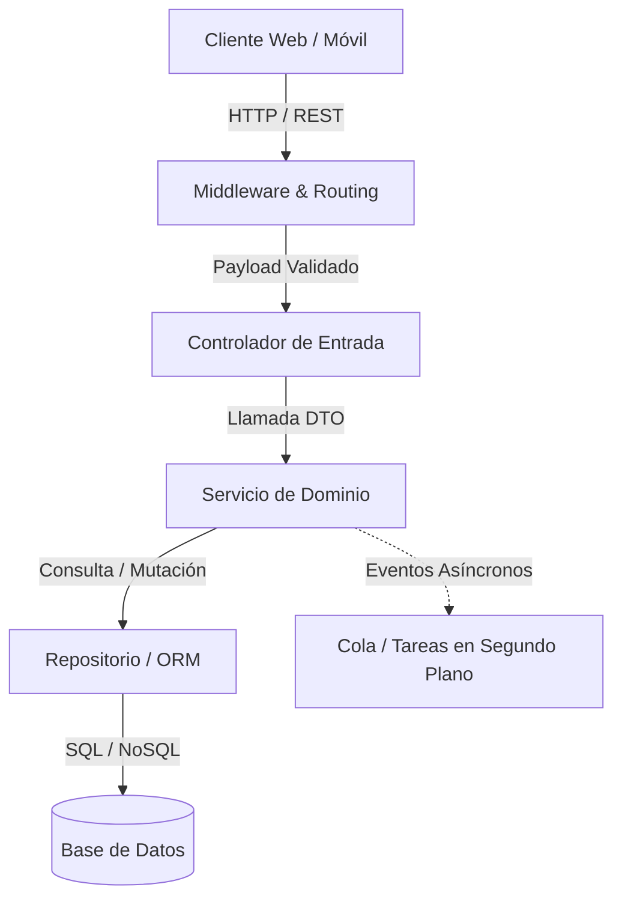

# Mapa Mental del Sistema y Flujo de Datos (System Map)

> **Propósito**: Proveer a los agentes una visión panorámica instantánea de cómo interactúan los componentes sin tener que inspeccionar docenas de archivos.

---

## 1. Diagrama de Flujo Principal

---

## 2. Mapa de Directorios Clave

- `src/controllers/`: Controladores de transporte y formateo de respuesta.
- `src/services/`: Lógica pura de negocio y reglas de dominio.
- `src/repositories/` o `src/models/`: Persistencia, consultas e interfaces de datos.
- `src/middlewares/`: Autenticación, control de permisos y validación de esquemas.
- `src/core/` / `src/shared/`: Utilidades comunes, tipos transversales y constantes.

---

## 3. Principales Integraciones Externas

- **Servicios Cloud**: APIs de terceros, almacenamiento de objetos, autenticación federada.
- **Base de Datos Principal**: Motor de base de datos y estrategia de migración.
- **Pasarelas / Motores de IA**: Conexión con proveedores de inferencia locales o cloud.
