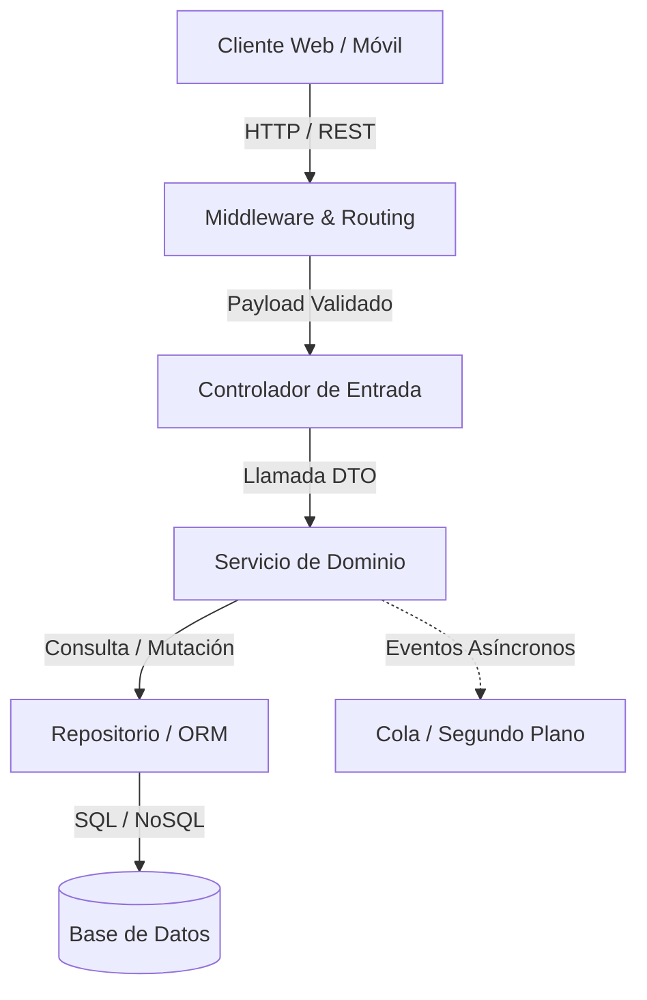

# Cerebro del Proyecto (Project Long-Term Brain)

> **Memoria a Largo Plazo**: Este documento almacena el conocimiento acumulado, las decisiones de arquitectura, el mapa mental del sistema y las lecciones aprendidas para evitar amnesia entre sesiones de chat y prevenir la repetición de errores pasados.

---

## 1. Mapa Mental del Sistema (*System Mental Model*)

---

## 2. Lecciones Aprendidas Categorizadas (*Scoped Lessons Learned*)

> **Regla de Oro**: Cada vez que se resuelva un bug complejo o se descubra una incompatibilidad de librerías, registrar el antídoto aquí con `./task.sh learn`.

| ID | Fecha | Categoría | Problema Detectado | Causa Raíz | Solución Definitiva (Antídoto) | Estado |
| :---: | :---: | :---: | :--- | :--- | :--- | :---: |
| `LL-001` | YYYY-MM-DD | `[DATABASE]` | Ejemplo: Bloqueos de concurrencia | Modo journal DELETE por defecto | Configurar `PRAGMA journal_mode = WAL;` y `busy_timeout = 5000` | `ACTIVO` |
| `LL-002` | YYYY-MM-DD | `[FRONTEND]` | Ejemplo: Fugas de memoria reactivas | Suscripciones abiertas sin destruir | Usar `takeUntilDestroyed` o Signals puros | `ACTIVO` |

---

## 3. Quirks y Trampas Conocidas del Stack Tecnológico (*Gotchas*)

| Tecnología / Librería | Versión | Comportamiento Inesperado (Quirk) | Regla de Prevención Obligatoria |
| :--- | :---: | :--- | :--- |
| `[Librería / Framework]` | `[x.y]` | [Descripción de la trampa o bug conocido] | [Cómo evitarlo o qué sintaxis usar] |

---

## 4. Diccionario del Dominio (*Ubiquitous Language & Invariants*)

| Término de Negocio | Definición Precisa | Invariante / Regla Inquebrantable |
| :--- | :--- | :--- |
| **Usuario Activo** | Sujeto autenticado con cuenta válida | No puede acceder a operaciones si su estado es `SUSPENDED` |
| **Registro Inmutable** | Datos críticos con sello de tiempo | Los identificadores primarios y logs nunca pueden modificarse |

---

## 5. Preferencias del Desarrollador (*Human Preferences*)

- **Límites de Tamaño**: Componentes y funciones concisas (archivos menores a 200 líneas preferiblemente).
- **Tipado Estricto**: TypeScript estricto; prohibido el uso indiscriminado de `any`.
- **Formato de Respuestas**: Toda respuesta de API sigue el envoltorio `{ success: boolean, data?: T, error?: { code, message } }`.
- **Diseño & UI**: Emplear exclusivamente los tokens globales de diseño; prohibido colocar valores arbitrarios en línea.

---

## 6. Registro de Deuda Técnica Aceptada (*Technical Debt*)

> Para más detalles, consultar [`.agents/brain/tech_debt.md`](./.agents/brain/tech_debt.md).

| ID | Tarea Vinculada | Descripción de la Deuda | Solución Temporal Aplicada | Acción Definitiva Pendiente | Prioridad |
| :---: | :---: | :--- | :--- | :--- | :---: |
| `TD-001` | `[TASK-XXX]` | [Descripción breve de la deuda técnica] | [Workaround aplicado] | [Refactorización definitiva pendiente] | `[MEDIA/BAJA]` |
