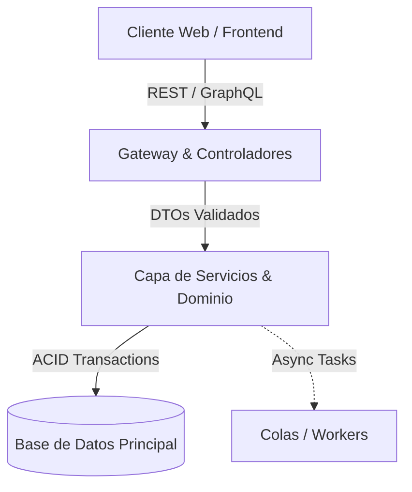

# [NOMBRE_DEL_PROYECTO]

[](#)
[](#)
[](#)

> [Breve descripción clara y concisa del valor que aporta este proyecto].

---

## 🏗️ Arquitectura del Sistema



---

## 🚀 Inicio Rápido en 3 Pasos

### 1. Requisitos Previos
- Node.js >= 20.x / Python >= 3.11 (según el stack)
- Git instalado

### 2. Instalación y Configuración
```bash
# 1. Clonar el repositorio
git clone <url-del-repositorio>
cd <nombre-del-proyecto>

# 2. Configurar variables de entorno
cp .env.example .env

# 3. Instalar dependencias
npm install
```

### 3. Ejecución en Modo Desarrollo
```bash
npm run dev
```

---

## 🧪 Pruebas Automatizadas y Calidad

```bash
# Ejecutar suite de pruebas
npm test

# Compilación de producción
npm run build
```

---

## 🤖 Gobernanza Multi-Agente

Este proyecto está respaldado por el **Ecosistema Multi-Agente Antigravity**:
- **Única Fuente de Verdad (SSOT)**: Consulta y actualiza tareas en [`GLOBAL_STATE.md`](./GLOBAL_STATE.md).
- **Cerebro y Lecciones Aprendidas**: Consulta el conocimiento acumulado en [`BRAIN.md`](./BRAIN.md).
- **Reglas del Equipo**: Normas de desarrollo y propiedad de código en [`AGENTS.md`](./AGENTS.md).
- **Gestión de Tareas**:
  ```bash
  # Ver estado del proyecto
  ./.agents/scripts/task.sh metrics
  ```

---

## 📄 Licencia

Este proyecto está bajo la Licencia MIT. Consulta el archivo `LICENSE` para más información.
