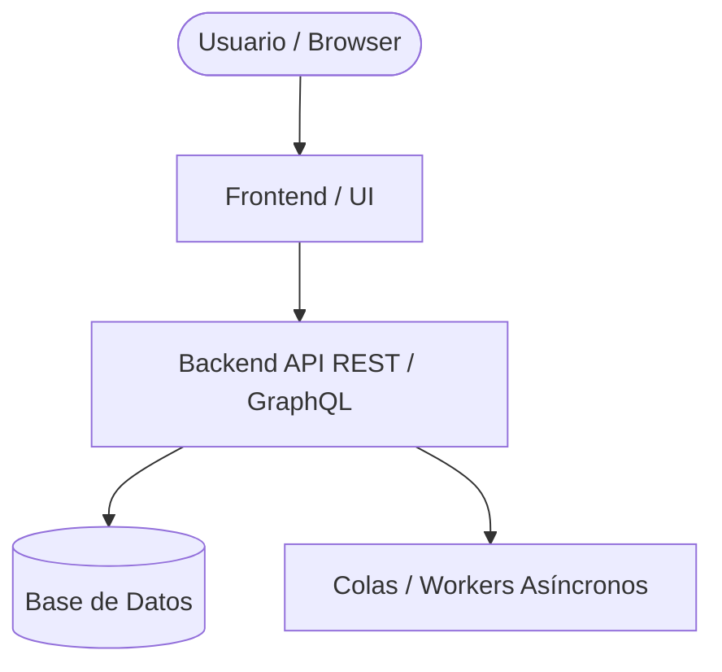

# Guía de Onboarding para Desarrolladores: [Nombre del Proyecto]

> ¡Bienvenido al equipo! Este documento resume todo lo que necesitas para configurar tu entorno local, entender la arquitectura del sistema y colaborar fluidamente con los agentes de IA de SKILL MAESTRO.

---

## 1. Puesta en Marcha Rápida (Setup Local)

Requisitos mínimos: `git`, `bash`, `python3` (versión compatible según stack) y el gestor de paquetes (`npm`, `pnpm` o `poetry`).

```bash
# 1. Clonar el repositorio
git clone <url-del-repositorio> && cd <nombre-del-proyecto>

# 2. Instalar dependencias del proyecto y activar hooks de protección
npm install          # o poetry install
./.agents/scripts/install-hooks.sh

# 3. Configurar variables de entorno y levantar servicios locales
cp .env.example .env
npm run dev          # o docker-compose up -d
```

---

## 2. Mapa de Arquitectura y Tecnologías Clave

- **Stack Declarado**: `[Stack de GLOBAL_STATE.md §2]`
- **Capa Frontend**: `[Rutas de vistas, componentes y estado reactivo]`
- **Capa Backend / APIs**: `[Rutas de endpoints, controladores y servicios]`
- **Persistencia**: `[Motor de BD, ORM y migraciones]`



---

## 3. Dinámica de Trabajo con los Agentes de IA

Este repositorio se gobierna con el sistema multi-agente **SKILL MAESTRO**:
- **Regla de Oro**: Ningún cambio de código se realiza sin una tarea activa (`TASK-XXX`).
- **Punto de Entrada**: Para pedir una funcionalidad usa `/nueva-tarea`; para reportar un error usa `/bugfix`; para emergencias usa `/hotfix`.
- **Validación Humana**: Antes de entregar una pantalla a QA, el agente `user-testing-agent` prueba la experiencia visual con `/probar-usuario`.
- **Cerebro Persistente**: Las lecciones aprendidas viven en `BRAIN.md`. Revísalas para conocer los antipatrones prohibidos del proyecto.

---

## 4. Comandos Canónicos de Verificación

```bash
./.agents/scripts/task.sh doctor    # Diagnóstico general de salud del proyecto
./.agents/scripts/task.sh list      # Ver tareas activas y backlog
npm test                            # Batería de pruebas automatizadas
```
