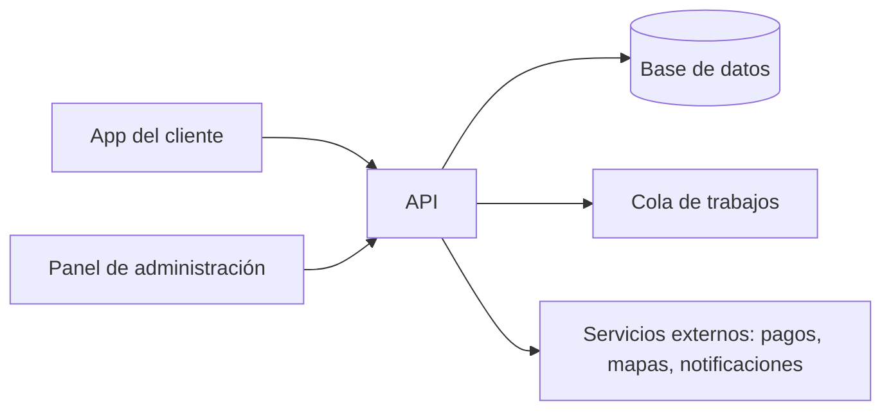

# Plan Maestro: [Nombre del proyecto]

> **Autor**: `orchestrator-agent` (`/crear-plan`)  
> **Fecha**: YYYY-MM-DD · **Versión del plan**: 1  
> **Estado**: `DRAFT` | `IN_REVIEW` | `APPROVED`  
> **Entradas**: [docs/research/...](../research/) · [docs/product/...](../product/)  
> **Supuestos de equipo**: [p. ej. 1 persona a tiempo completo con agentes de IA]

---

## 1. Visión y objetivo
- **Qué construimos y para quién**: [una frase]
- **Métrica de éxito**: [p. ej. 500 viajes semanales a los 3 meses del lanzamiento]

## 2. Alcance por versiones

| Versión | Incluye | Justificación (historia de usuario / informe) |
| :--- | :--- | :--- |
| MVP | [...] | [US-001, informe §5] |
| v1 | [...] | [...] |
| v2 | [...] | [...] |
| Fuera de alcance | [...] | [por qué] |

## 3. Arquitectura general



| Pieza | Elección | Justificación | Estado |
| :--- | :--- | :--- | :--- |
| Frontend / Móvil | [...] | [...] | Declarado en §2 / `PENDIENTE DE CONFIRMAR` |
| Backend | [...] | [...] | [...] |
| Persistencia | [...] | [...] | [...] |
| Despliegue | [...] | [...] | [...] |

**ADR candidatos**: [decisión] → `docs-architecture-agent`.

## 4. Módulos y responsables

| Módulo | Versión | Agente | Skills de stack y técnica |
| :--- | :--- | :--- | :--- |
| [Autenticación] | MVP | `backend-agent` | `stack-*`, `security-hardening` |

## 5. Fases

### Fase 1: [Nombre] — [rango de duración]
- **Objetivo**: [...]
- **Criterio de salida**: [qué funciona y cómo se comprueba]
- **Tareas candidatas**:

| # | Tarea | Agente | Criterios de aceptación (resumen) | Depende de | Talla |
| :--- | :--- | :--- | :--- | :--- | :--- |
| F1-1 | [...] | [...] | [...] | — | S/M/L |

(Repetir por fase.)

## 6. Cronograma

```mermaid
gantt
    title Plan por fases (rangos estimados)
    dateFormat YYYY-MM-DD
    section Fase 1
    Fundaciones        :f1, YYYY-MM-DD, 14d
    section Fase 2
    MVP núcleo         :f2, after f1, 28d
```

- **Camino crítico**: [F1-1 → F2-3 → F3-2 ...]
- **Duración total estimada**: [rango] con los supuestos de equipo de la cabecera.

## 7. Riesgos y supuestos

| Riesgo | Probabilidad | Impacto | Mitigación | Fase |
| :--- | :--- | :--- | :--- | :--- |
| [...] | Alta/Media/Baja | Alto/Medio/Bajo | [...] | [...] |

## 8. Estrategia de calidad y salida a producción
- **Pruebas**: [unitarias, integración y contratos (`testing-strategy`); flujos E2E (`e2e-testing`)]
- **Seguridad**: [revisión con `security-hardening` antes de exponer datos de usuarios]
- **Observabilidad**: [logs, métricas y alertas (`observability`)]
- **Criterio para lanzar**: [qué debe cumplirse para `/release`]

## 9. Plan de lanzamiento
- **Entornos**: [desarrollo, staging, producción]
- **Versiones**: [MVP privado → beta → v1 pública]
- **Qué medimos tras lanzar**: [eventos y métricas del PRD]

## 10. Preguntas abiertas
1. [...]

## 11. Seguimiento (real frente a planificado)

| Fase | Planificado | Real | Desviación y causa |
| :--- | :--- | :--- | :--- |
| Fase 1 | [rango] | [lo completa `/cerrar-fase`] | [...] |

## 12. Historial de cambios del plan

| Versión | Fecha | Cambio | Aprobado por |
| :--- | :--- | :--- | :--- |
| 1 | YYYY-MM-DD | Plan inicial | [usuario] |
