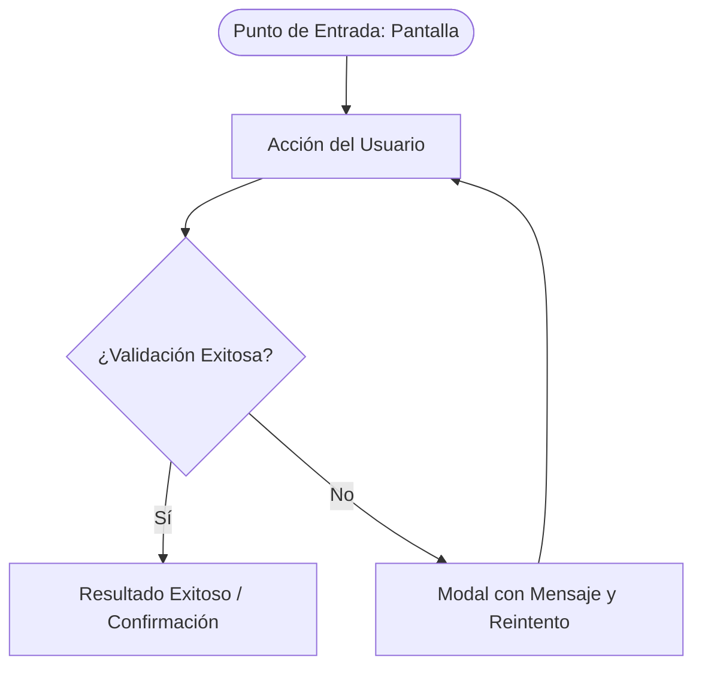

# PRD: [Nombre de la Funcionalidad o Módulo]

> **Autor / PM**: `product-manager-agent`  
> **Fecha**: YYYY-MM-DD  
> **Estado**: `DRAFT` | `IN_REVIEW` | `APPROVED`  
> **Prioridad**: `MUST_HAVE` | `SHOULD_HAVE` | `COULD_HAVE`

---

## 1. Problema de Negocio y Objetivo
- **Problema Detectado**: [Describir el dolor del usuario o ineficiencia actual]
- **Solución Propuesta**: [Descripción clara de alto nivel de la funcionalidad]
- **Objetivo / KPI de Éxito**:
  - [Métrica 1: ej. Tasa de conversión > 12%]
  - [Métrica 2: ej. Reducción de tiempo de onboarding a < 60 segundos]

---

## 2. Recorrido del Usuario (User Journey Flow)



---

## 3. Historias de Usuario con Criterios de Aceptación (DoD)

### US-001: [Título de la Historia]
- **Como**: `[Perfil de usuario]`
- **Quiero**: `[Acción deseada]`
- **Para**: `[Beneficio o valor esperado]`

#### Criterios de Aceptación (Formato Gherkin):
```gherkin
Escenario 1: Flujo Exitoso (Happy Path)
  Dado que el usuario ha completado el formulario correctamente
  Cuando presiona el botón "Confirmar"
  Entonces el sistema procesa la solicitud, muestra la pantalla de éxito y envía una confirmación.

Escenario 2: Datos Inválidos o Faltantes
  Dado que el usuario omite un campo obligatorio
  Cuando intenta presionar "Confirmar"
  Entonces el sistema bloquea el envío, resalta el campo en rojo y muestra el mensaje descriptivo.

Escenario 3: Error de Red o Servidor
  Dado que el dispositivo pierde conectividad a internet
  Cuando el usuario intenta enviar la acción
  Entonces el sistema muestra un banner no intrusivo indicando la falta de conexión y permite reintentar.
```

---

## 4. Matriz de Estados de Pantalla (Screen State Matrix)

| Estado | Comportamiento Visual / Componente | Acción Posible del Usuario |
| :--- | :--- | :--- |
| **1. Loading** | Skeleton loader imitando la estructura de la información | Espera visual (sin inputs bloqueantes) |
| **2. Empty State** | Mensaje empático + Ilustración + Botón de acción primaria | Botón CTA para crear/iniciar primer elemento |
| **3. Success** | Lista o vista poblada con datos y controles activos | Clic en elementos, filtros y navegación |
| **4. Error** | "Ocurrió un error al cargar la información" + Botón Reintentar | Clic en "Reintentar" o contacto con soporte |

---

## 5. Eventos de Analítica y Telemetría

| Nombre del Evento | Momento de Activación | Propiedades Contextuales (Payload) |
| :--- | :--- | :--- |
| `feature_viewed` | Carga inicial de la pantalla | `{ source: "dashboard_menu", user_role: "admin" }` |
| `feature_action_started` | Clic en el botón principal de inicio | `{ item_id: "...", step: 1 }` |
| `feature_action_completed`| Transacción finalizada con éxito | `{ duration_seconds: 45, result: "success" }` |
| `feature_action_failed` | Fallo de validación o caída de red | `{ error_code: "NETWORK_TIMEOUT", attempt: 2 }` |

---

## 6. Dependencias y Traspaso Técnico
- **Asignado a**: `orchestrator-agent` para creación de tareas técnicas (`TASK-XXX`).
- **Impacto Frontend/Mobile**: Pantallas y componentes involucrados.
- **Impacto Backend/DB**: Endpoints y contratos DTO requeridos.
- **Validado por**: `qa-security-agent` contra los escenarios Gherkin arriba descritos.
