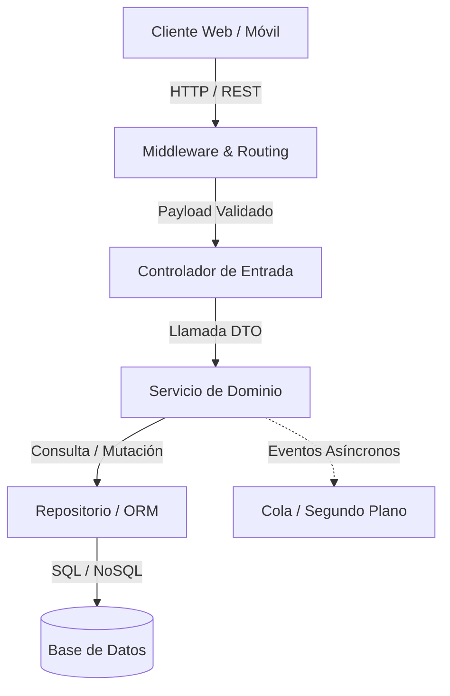

# Cerebro del Proyecto (Project Long-Term Brain)

> **Memoria a Largo Plazo**: Este documento almacena el conocimiento acumulado, las decisiones de arquitectura, el mapa mental del sistema y las lecciones aprendidas para evitar amnesia entre sesiones de chat y prevenir la repetición de errores pasados.

---

## 1. Mapa Mental del Sistema (*System Mental Model*)

---

## 2. Lecciones Aprendidas Categorizadas (*Scoped Lessons Learned*)

> **Regla de Oro**: Cada vez que se resuelva un bug complejo o se descubra una incompatibilidad de librerías, registrar el antídoto aquí con `./task.sh learn`.

| ID | Fecha | Categoría | Problema Detectado | Causa Raíz | Solución Definitiva (Antídoto) | Estado |
| :---: | :---: | :---: | :--- | :--- | :--- | :---: |
| `LL-001` | 2026-10-10 | `[DATABASE]` | Bloqueos de concurrencia en SQLite | Modo journal DELETE bloquea lecturas | Configurar `PRAGMA journal_mode = WAL;` y `busy_timeout = 5000` | `ACTIVO` |
| `LL-002` | 2026-10-10 | `[FRONTEND]` | Fugas de memoria en componentes | Suscripciones abiertas sin destruir | Prohibido suscribirse sin `takeUntilDestroyed` o usar Signals puros | `ACTIVO` |
| `LL-003` | 2026-10-10 | `[SECURITY]` | Fuga de detalles internos en errores 500 | Respuestas crudas de base de datos | Middleware centralizado de errores que anonimiza trazas en producción | `ACTIVO` |
| `LL-004` | 2026-10-29 | `[SECURITY]` | scan-secrets no revisaba archivos con tildes, comillas o barras invertidas en el nombre (configuración.ts salía limpio con una clave dentro) | Con core.quotePath activo git devuelve las rutas no ASCII entre comillas y con escapes octales; core.quotePath=false solo arregla los no ASCII, porque git sigue entrecomillando rutas con comilla doble o barra invertida; [ -f ] y git diff -- con esa ruta no encuentran el archivo | En scripts que leen rutas de git usar siempre salida -z (git diff --name-only -z, ls-files -z) con while IFS= read -r -d ''; como mínimo git -c core.quotePath=false; añadir un test con un nombre no ASCII | `ACTIVO` |
| `LL-005` | 2026-10-29 | `[SECURITY]` | Un secreto commiteado en la rama y borrado en un commit posterior pasaba el escáner de QA | El escáner comparaba solo el merge-base con el árbol de trabajo (diff neto), y el secreto sigue en el historial y se publica con push o merge sin squash | Revisar las líneas añadidas de cada commit de la rama con git log -p -U0 merge-base..HEAD; si aparece, rotar la clave y reescribir el historial antes de publicar | `ACTIVO` |

---

## 3. Quirks y Trampas Conocidas del Stack Tecnológico (*Gotchas*)

| Tecnología / Librería | Versión | Comportamiento Inesperado (Quirk) | Regla de Prevención Obligatoria |
| :--- | :---: | :--- | :--- |
| **SQLite (Nativo/Prisma)** | Todas | Claves foráneas desactivadas por defecto | Ejecutar `PRAGMA foreign_keys = ON;` al abrir la conexión |
| **Node.js (Fetch API)** | >= 20.x | Cabecera `Host` es gestionada automáticamente | No forzar cabecera `Host` manual en peticiones locales para evitar fallos |
| **CSS / Token System** | Modern | Colores en línea rompen temas oscuros | Usar siempre variables semánticas (`--bg-primary`, `--text-primary`) |
| **Next.js + Prisma** | 15.x / 6.x | Hot-reload en desarrollo reinstancia el cliente y satura el pool de conexiones | Instanciar PrismaClient como singleton global en `globalThis` (`lib/prisma.ts`) |
| **Express 5** | >= 5.x | `req.query` es un getter de solo lectura; reasignarlo lanza excepción | Parsear a una variable o constante nueva con esquema Zod (`const q = Query.parse(req.query)`) |
| **Angular SSR** | 22.x | Peticiones con cabecera `Host` arbitraria abren vectores de ataque SSRF | Configurar dominios en `build.options.security.allowedHosts` o variable `NG_ALLOWED_HOSTS` |
| **Git (rutas en scripts)** | Todas | `core.quotePath` entrecomilla y escapa rutas no ASCII; con `quotePath=false` siguen entrecomilladas las que tienen `"` o `\` | Leer rutas con `-z` y `read -r -d ''`; nunca con la salida por defecto de `git diff --name-only` o `ls-files` |
| **Stripe Webhooks** | Express 5 | `express.json()` altera el stream de bytes original y rompe la verificación de firma | Montar la ruta del webhook con `express.raw({ type: 'application/json' })` antes de `express.json()` |

---

## 4. Diccionario del Dominio (*Ubiquitous Language & Invariants*)

| Término de Negocio | Definición Precisa | Invariante / Regla Inquebrantable |
| :--- | :--- | :--- |
| **Usuario Activo** | Sujeto autenticado con cuenta válida | No puede acceder a operaciones si su estado es `SUSPENDED` |
| **Registro Inmutable** | Datos críticos con sello de tiempo | Los identificadores primarios y logs nunca pueden modificarse |

---

## 5. Preferencias del Desarrollador (*Human Preferences*)

- **Límites de Tamaño**: Componentes y funciones concisas (archivos menores a 200 líneas preferiblemente).
- **Tipado Estricto**: TypeScript estricto; prohibido el uso indiscriminado de `any`.
- **Formato de Respuestas**: Toda respuesta de API sigue el envoltorio `{ success: boolean, data?: T, error?: { code, message } }`.
- **Diseño & UI**: Emplear exclusivamente los tokens globales de diseño; prohibido colocar valores arbitrarios en línea.

---

## 6. Registro de Deuda Técnica Aceptada (*Technical Debt*)

> Para más detalles, consultar [`.agents/brain/tech_debt.md`](./.agents/brain/tech_debt.md).

| ID | Tarea Vinculada | Descripción de la Deuda | Solución Temporal Aplicada | Acción Definitiva Pendiente | Prioridad |
| :---: | :---: | :--- | :--- | :--- | :---: |
| `TD-001` | `TASK-001` | Paginación en memoria en endpoint de listado | Retorna array completo acotado a 100 registros | Implementar paginación SQL con `LIMIT / OFFSET` y cursor | `MEDIA` |
