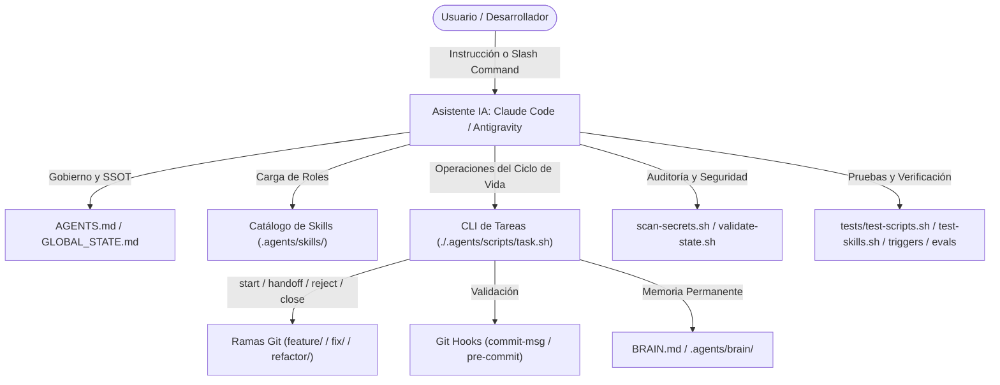

# Cerebro del Proyecto (Project Long-Term Brain)

> **Memoria a Largo Plazo**: Este documento almacena el conocimiento acumulado, las decisiones de arquitectura, el mapa mental del sistema y las lecciones aprendidas para evitar amnesia entre sesiones de chat y prevenir la repetición de errores pasados.

---

## 1. Mapa Mental del Sistema (*System Mental Model*)

---

## 2. Lecciones Aprendidas Categorizadas (*Scoped Lessons Learned*)

> **Regla de Oro**: Cada vez que se resuelva un bug complejo o se descubra una incompatibilidad de librerías, registrar el antídoto con `./.agents/scripts/task.sh learn`.
>
> **Tabla generada**: la fuente única es [`.agents/brain/lessons_learned.md`](./.agents/brain/lessons_learned.md); esta copia se regenera con `task.sh brain sync` y no se edita a mano. **Ámbito** = rutas a las que aplica la lección (`*` = general). Para ver solo lo relevante: `task.sh brain for TASK-XXX [ruta...]` o `task.sh brain search <términos>`.

| ID | Fecha | Categoría | Problema Encontrado | Causa Raíz | Solución Aplicada (Antídoto) | Ámbito | Estado |
| :---: | :---: | :---: | :--- | :--- | :--- | :--- | :---: |
| `LL-001` | 2026-10-29 | `[SCRIPTS]` | awk en macOS/BSD no reconoce la secuencia de escape `\s` para espacios en blanco | `\s` es una extensión de GNU awk; el awk BSD de macOS lo interpreta literalmente como el carácter 's' | Usar clases POSIX `[[:space:]]` o conjuntos explícitos `[ \t]` en scripts para compatibilidad portátil entre macOS y Linux | `.agents/scripts/*.sh,tests/*.sh` | `ACTIVO` |
| `LL-002` | 2026-10-29 | `[GIT]` | `git diff -S` omitía commits donde el recuento total de apariciones de la cadena no cambiaba | `-S` (pickaxe) detecta únicamente adiciones o eliminaciones netas en el conteo de ocurrencias exactas de una cadena, no sustituciones o regex | Usar `-G` para evaluar expresiones regulares o recorrer los diffs individuales de cada commit con `git log -p -U0 merge-base..HEAD` | `.agents/scripts/scan-secrets.sh` | `ACTIVO` |
| `LL-003` | 2026-10-29 | `[DEVOPS]` | `task.sh start` generaba slugs de rama con apóstrofes o guiones (`auditor-ia`) ante títulos con tildes en macOS | `iconv -t ascii//TRANSLIT` en macOS BSD translitera tildes agregando apóstrofes (`'i`) en lugar de letras planas | Normalizar vía `python3 unicodedata.normalize('NFKD')` o, sin python3, sustituciones explícitas `sed -e 's/á/a/g' ...` (nunca `y///`, que falla en locale C: ver LL-007) | `.agents/scripts/task.sh,.agents/scripts/brain-lib.sh` | `ACTIVO` |
| `LL-004` | 2026-10-29 | `[SECURITY]` | scan-secrets no revisaba archivos con tildes, comillas o barras invertidas en el nombre (configuración.ts salía limpio con una clave dentro) | Con core.quotePath activo git devuelve las rutas no ASCII entre comillas y con escapes octales; core.quotePath=false solo arregla los no ASCII, porque git sigue entrecomillando rutas con comilla doble o barra invertida; [ -f ] y git diff -- con esa ruta no encuentran el archivo | En scripts que leen rutas de git usar siempre salida -z (git diff --name-only -z, ls-files -z) con while IFS= read -r -d ''; como mínimo git -c core.quotePath=false; añadir un test con un nombre no ASCII | `.agents/scripts/scan-secrets.sh,.agents/hooks/*` | `ACTIVO` |
| `LL-005` | 2026-10-29 | `[SECURITY]` | Un secreto commiteado en la rama y borrado en un commit posterior pasaba el escáner de QA | El escáner comparaba solo el merge-base con el árbol de trabajo (diff neto), y el secreto sigue en el historial y se publica con push o merge sin squash | Revisar las líneas añadidas de cada commit de la rama con git log -p -U0 merge-base..HEAD; si aparece, rotar la clave y reescribir el historial antes de publicar | `.agents/scripts/scan-secrets.sh` | `ACTIVO` |
| `LL-006` | 2026-11-10 | `[DEVOPS]` | sed: el & en el reemplazo es el texto coincidente | En init-project.sh el reemplazo 'Infraestructura & Despliegue' sin escapar corrompia GLOBAL_STATE.md en las ramas --stack (el & se expande al patron completo), y el patron '[Breve descripcion.*' se comia el backtick de cierre; los tests solo buscaban 2 placeholders y no lo vieron | Escapar como \& en el reemplazo de sed, acotar patrones con [^]]*\] en vez de .* y comprobar en tests la linea resultante completa, no solo la ausencia de placeholders | `.agents/scripts/*.sh` | `ACTIVO` |
| `LL-007` | 2026-11-10 | `[DEVOPS]` | tolower de awk y sed y/// no normalizan tildes en locale C | En macOS con LC_CTYPE=C el tolower de awk BSD no baja letras acentuadas y sed y/// con multibyte falla con transform strings are not the same length; con 2>/dev/null el fallo queda mudo y la comparacion de textos se desactiva | Normalizar con python3 unicodedata (NFKD) antes de comparar, probar siempre con LC_ALL=C y no silenciar stderr de una tuberia cuyo resultado vacio cambia el comportamiento | `.agents/scripts/*.sh,tests/*.sh` | `ACTIVO` |
| `LL-008` | 2026-11-11 | `[DEVOPS]` | Regenerar una tabla derivada borraba filas que solo estaban en la copia | brain sync reemplazaba la tabla de BRAIN.md con la fuente sin comprobar que la fuente contuviera todas sus filas; en proyectos antiguos sin lessons_learned.md dejaba 0 lecciones y salia con codigo 0 | Antes de sobrescribir una copia derivada, adoptar en la fuente lo que solo exista en la copia y abortar sin escribir si la fuente no es valida; probar siempre la actualizacion desde la version anterior instalada | `.agents/scripts/brain-lib.sh,.agents/scripts/init-project.sh` | `ACTIVO` |
| `LL-009` | 2026-11-11 | `[DEVOPS]` | close decidia la leccion obligatoria por el contador n/3 y reject anotaba la reincidencia antes de registrar el rechazo | El contador n/3 es estado reiniciable (move lo deja en 0/3 al salir de BLOCKED), asi que la tarea mas rechazada cerraba sin leccion; y la escritura opcional de recurrences.md iba antes de set_task y log_history bajo set -e, de modo que un fallo de permisos abortaba el veto de QA | Decidir las obligaciones por el registro historico (filas Rechazo n/3 de la tarea en el historial), no por contadores que otro comando reinicia; ejecutar los efectos secundarios opcionales (metricas, avisos) despues de la transicion principal y de forma no fatal (cmd 2>/dev/null o aviso); probar cada control tras BLOCKED + move y con archivos de solo lectura | `.agents/scripts/task.sh,.agents/scripts/brain-lib.sh` | `ACTIVO` |
| `LL-010` | 2026-11-11 | `[DOCS]` | Una skill nueva contradecia reglas del gobierno y convenciones de skills vecinas | security-hardening admitia vulnerabilidades altas como deuda (la deuda nunca es de seguridad) y observability usaba /health y /ready frente a /healthz y /readyz de devops-cloud-agent y los stacks; se escribio cada skill aislada sin cruzarla con AGENTS.md, tech_debt.md y las skills a las que remite | Antes de entregar una skill, buscar con grep en .agents/skills, AGENTS.md y .agents/brain cada regla, ruta, comando y umbral que cita y alinear con la convencion existente; las skills que se remiten entre si deben usar los mismos nombres; si dos skills encadenadas pueden ejecutar la misma accion (registrar tareas, anadir un hito), asignarla a una sola y que la otra lo diga, y que los limites de las descripciones vayan en los dos sentidos | `.agents/skills/` | `ACTIVO` |
| `LL-011` | 2026-11-11 | `[SECURITY]` | Recetas de seguridad (SSRF, DNS rebinding) imprecisas por no contrastarlas con la documentacion de cada lenguaje | La receta anti DNS rebinding de security-hardening funcionaba solo en un caso (http.Agent) y rompia TLS en Python o no aplicaba a fetch; la lista cerrada de rangos dejaba huecos y los tests no cubrian el ataque real (un nombre que resuelve a IP interna) | En una skill de seguridad comprobar cada receta concreta con la documentacion del lenguaje y sus variantes (HTTPS, fetch, versiones), preferir listas de permitidos (solo unicast global) a listas de bloqueo, y acompanar cada control del test del ataque que lo motiva, ejecutado con el mismo cliente real; un gancho de DNS (lookup) no ve las URLs con IP literal: validar tambien la IP literal tras normalizar la URL (quitando los corchetes de IPv6 que conserva URL.hostname en Node; en Python urllib no normaliza 2130706433: si ipaddress falla, resolver con getaddrinfo y validar) | `.agents/skills/security-hardening/` | `ACTIVO` |
| `LL-012` | 2026-11-11 | `[DEVOPS]` | awk FNR==NR falla con primer archivo vacio y bucle de mkdir roba lock ajeno | Si el primer archivo tiene 0 lineas NR queda en 0 y FNR==NR aplica al segundo; comprobar -d tras timeout de mkdir marca LOCK_HELD sobre lock ajeno | Validar cabecera previa con grep y usar FILENAME==ENVIRON[...] en vez de FNR==NR; fijar LOCK_HELD=1 solo cuando mkdir tiene exito | `.agents/scripts/*.sh,tests/*.sh` | `ACTIVO` |
| `LL-013` | 2026-11-11 | `[TESTING]` | Eval de evals.json dio falso positivo inicial porque setup dejo GLOBAL_STATE.md sin commitear antes de eval-start | run_evals.py etiqueta HEAD como eval-start tras setup; sin commit en setup, git diff eval-start muestra filas de tareas ya creadas y greps laxos coinciden con criterios de §5 | En fixtures que crean tareas con task.sh, ejecutar git add -A y commit antes de eval-start, y verificar siempre que cada check no invariante falla tras setup y pasa tras aplicar la skill | `tests/evals/**` | `ACTIVO` |
| `LL-014` | 2026-11-12 | `[DOCS]` | Recetas en references/ usaban rutas de import, nombres de settings/DI y excepciones incompatibles con los stacks | Se escribieron ejemplos de framework de memoria sin contrastarlos con stack-*/references/*, api_response_template.ts y la version real de cada SDK | Antes de cerrar una receta por stack, verificar cada ruta de import y extension (.ts en ESM nodenext), firmas de dependencias/Settings (get_session, minusculas Pydantic), configuracion del framework (experimental.serverActions.allowedOrigins, openapi_url=None) y mapeo de excepciones de terceros a errores HTTP 4xx | `.agents/skills/**/references/*,.agents/skills/*/SKILL.md` | `ACTIVO` |
| `LL-015` | 2026-11-16 | `[DEVOPS]` | Un hook que decide por prefijo de ruta se esquivaba con segmentos .. (.agents/../src/app.ts pasaba como ruta exenta) | require-active-task.sh y brain-context.sh comparaban el texto de file_path con prefijos (.agents/, docs/) sin normalizarlo; ademas una ruta relativa fuera del proyecto (../otro) se trataba como del proyecto y se bloqueaba | En todo control por ruta normalizar antes de decidir (python3 os.path.realpath en la ruta y en la raiz, que resuelve tambien symlinks, + relpath contra la raiz; centinela y exit 2 si la ruta no es texto), tratar como externa cualquier ruta cuyo relpath empiece por .., y probar el control con ., .. y rutas relativas | `.agents/scripts/require-active-task.sh,.agents/scripts/brain-context.sh,.agents/hooks/*` | `ACTIVO` |
| `LL-016` | 2026-11-16 | `[DEVOPS]` | trap de INT/TERM que solo limpia deja que bash siga ejecutando el script tras la senal | task.sh registraba trap release_lock EXIT INT TERM: al recibir SIGTERM liberaba el lock y continuaba escribiendo GLOBAL_STATE.md sin bloqueo; install-hooks.sh ademas asumia que .git es un directorio y fallaba en worktrees | Separar trap de EXIT (limpieza) de los de INT/TERM (limpieza + exit 130/143); preguntar a git por sus rutas (git rev-parse --git-path hooks, --is-inside-work-tree) en lugar de suponer .git/; probar con un worktree y enviando la senal en mitad de una escritura | `.agents/scripts/*.sh,tests/*.sh` | `ACTIVO` |
| `LL-017` | 2026-11-17 | `[TESTING]` | Evals que aceptaban soluciones tramposas y rechazaban correctas | Los checks se validaron solo con el estado inicial (FAIL_INIT) y una unica solucion de referencia; usaban grep sobre el codigo y valores de prueba que no distinguian implementaciones (floor, round y trunc dan lo mismo con fraccion .33), y un store simulado que nunca tenia el id ocultaba marcar como procesado antes de enviar | Validar cada eval con una matriz de soluciones: varias correctas que deben pasar y trampas tipicas que deben fallar; preferir checks de comportamiento y de mutacion a grep; elegir valores de prueba que separen las implementaciones candidatas; fijar en los criterios de la tarea la firma y la regla exacta que el check comprueba; al cambiar una entrada simulada para aceptar una solucion correcta, conservar la variante anterior como caso adicional del check y repasar la matriz completa | `tests/evals/` | `ACTIVO` |
| `LL-018` | 2026-11-17 | `[DEVOPS]` | Un envoltorio que reenvia rutas a un hook las resolvia con otra base que el cliente original | pre-edit-check.sh pasaba al hook la ruta relativa tal cual; el hook resuelve las relativas contra la raiz del proyecto porque Claude Code siempre envia absolutas, asi que desde un subdirectorio se comprobaba otro archivo (../src/app.ts quedaba fuera del proyecto y se permitia) | Cuando un comando reutiliza un hook, convertir sus entradas al formato exacto que envia el cliente real (rutas absolutas contra el directorio actual) y probar la paridad ejecutando desde la raiz y desde subdirectorios | `.agents/scripts/pre-edit-check.sh,.agents/scripts/require-active-task.sh,.agents/scripts/brain-context.sh` | `ACTIVO` |

---

## 3. Quirks y Trampas Conocidas (*Gotchas*)

Solo las trampas del entorno en que se desarrolla **esta librería** (shell, git y herramientas de texto). Las de cada tecnología de producto viven en su skill, que es donde el agente las necesita:

| Tecnología de producto | Dónde están sus trampas |
| :--- | :--- |
| Angular + Express + PostgreSQL (Express 5, Drizzle) | [`stack-angular-express-postgres`](.agents/skills/stack-angular-express-postgres/SKILL.md) |
| Next.js + Prisma + Tailwind | [`stack-nextjs-tailwind-prisma`](.agents/skills/stack-nextjs-tailwind-prisma/SKILL.md) |
| FastAPI + SQLAlchemy + Alembic | [`stack-fastapi-postgres`](.agents/skills/stack-fastapi-postgres/SKILL.md) |
| Stripe (webhooks y firma) | [`payments-stripe`](.agents/skills/payments-stripe/SKILL.md) |
| Angular SSR y hosts permitidos | [`seo-web`](.agents/skills/seo-web/SKILL.md) |
| SQLite (`PRAGMA` obligatorios) y configuración por motor | [`database-architect-agent`](.agents/skills/database-architect-agent/SKILL.md) |

| Herramienta | Versión | Comportamiento Inesperado (Quirk) | Regla de Prevención Obligatoria |
| :--- | :---: | :--- | :--- |
| **bash (macOS)** | 3.2 | No tiene `mapfile` ni arrays asociativos; un array vacío con `set -u` lanza `unbound variable` | Leer con `while IFS= read -r`; expandir como `${ARR[@]+"${ARR[@]}"}` |
| **awk (BSD)** | macOS | No reconoce `\s`; `tolower` no baja letras acentuadas en locale C | Usar `[[:space:]]`; normalizar tildes con `python3` antes de comparar |
| **sed** | BSD y GNU | `&` en el reemplazo es el texto coincidente; `-i` exige sufijo en BSD; `y///` con multibyte falla en locale C | Escapar `\&`; usar `sed -i.bak` y borrar el `.bak`; no usar `y///` con tildes |
| **awk (`-v`)** | BSD y GNU | `-v var="$x"` interpreta las barras invertidas: una regex `^\\|` llega como `^|` y casa con todo | Pasar patrones y texto del usuario por `ENVIRON["VAR"]`, nunca por `-v` |
| **Git (rutas en scripts)** | Todas | `core.quotePath` entrecomilla y escapa rutas no ASCII; con `quotePath=false` siguen entrecomilladas las que tienen `"` o `\` | Leer rutas con `-z` y `read -r -d ''`; nunca con la salida por defecto de `git diff --name-only` |
| **Git (`diff -S`)** | Todas | El pickaxe solo ve cambios netos en el número de apariciones | Para "líneas añadidas" usar `git log -p` y filtrar las líneas `+` dentro de cada hunk |
| **`mktemp` + `mv`** | Todas | El archivo final hereda los permisos `0600` del temporal | Restaurar los permisos originales tras sustituir un archivo |
| **Locale** | macOS | Las herramientas arrancan con `LC_CTYPE=C` en muchos entornos de agente | Probar con `LC_ALL=C` todo lo que compare o corte texto |

---

## 4. Diccionario del Dominio (*Ubiquitous Language & Invariants*)

> Glosario completo en [`.agents/brain/domain_glossary.md`](./.agents/brain/domain_glossary.md).

| Término | Definición Precisa | Invariante / Regla Inquebrantable |
| :--- | :--- | :--- |
| **Skill** | Instrucciones que se cargan por coincidencia de `description` o con `/nombre` | Se edita solo en `.agents/skills/`; `.claude/skills` es un enlace |
| **Tarea (`TASK-XXX`)** | Trabajo con agente asignado y criterios verificables | Su estado solo cambia con `task.sh` |
| **Veredicto** | Resultado de QA con evidencia en `.agents/reviews/` | El revisor nunca es el agente asignado |
| **Lección (`LL-XXX`)** | Problema, causa raíz y antídoto | El ID no se reutiliza; se retira como `OBSOLETA`, no se borra |
| **Deuda (`TD-XXX`)** | Solución provisional vinculada a una tarea | Nunca de seguridad; termina `SALDADA` |
| **Plantilla / Instancia** | `.agents/templates/` es genérico; la raíz es el estado de esta librería | Las plantillas no llevan lecciones ni deudas reales |

---

## 5. Preferencias del Desarrollador (*Human Preferences*)

> Detalle vinculante en [`.agents/brain/preferences.md`](./.agents/brain/preferences.md).

- **Idioma**: español en skills, documentación y mensajes; commits sin tildes y con `tipo(TASK-XXX): ...`.
- **Portabilidad**: scripts válidos en bash 3.2 de macOS y en Ubuntu, con awk y sed BSD y GNU; solo `git` y `python3` como dependencias.
- **Pruebas**: todo cambio de script o de skill lleva su prueba, y la prueba debe fallar con el código anterior.
- **Plantillas limpias**: nada del estado de la librería entra en `.agents/templates/`.

---

## 6. Registro de Deuda Técnica Aceptada (*Technical Debt*)

> Para más detalles, consultar [`.agents/brain/tech_debt.md`](./.agents/brain/tech_debt.md).

| ID | Tarea Vinculada | Descripción de la Deuda | Solución Temporal Aplicada | Acción Definitiva Pendiente | Prioridad |
| :---: | :---: | :--- | :--- | :--- | :---: |
